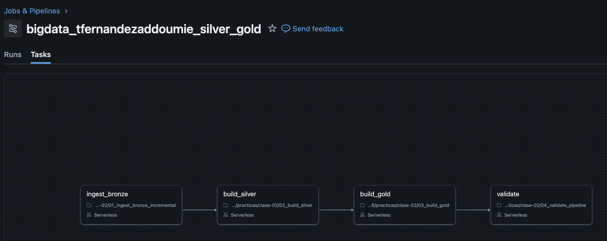
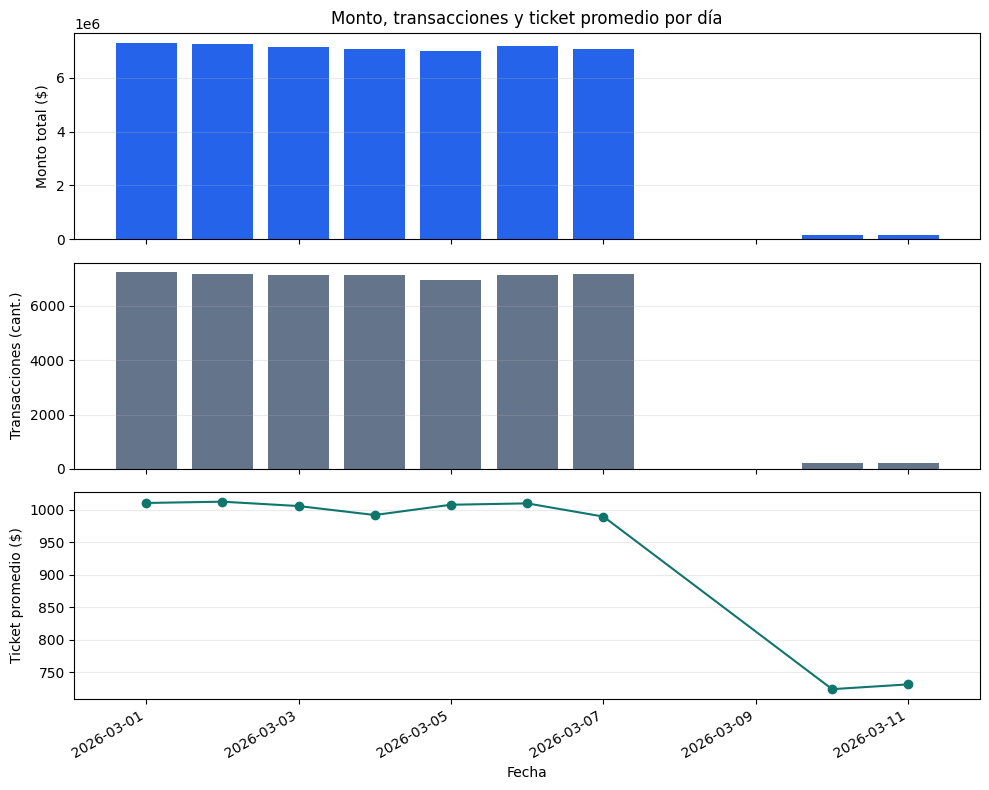
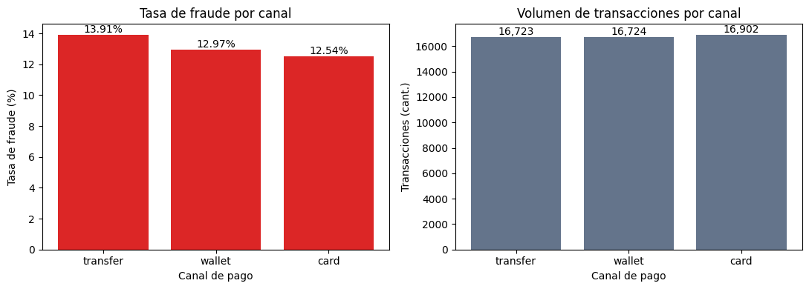
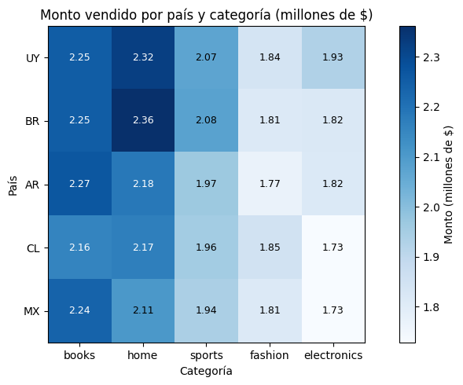
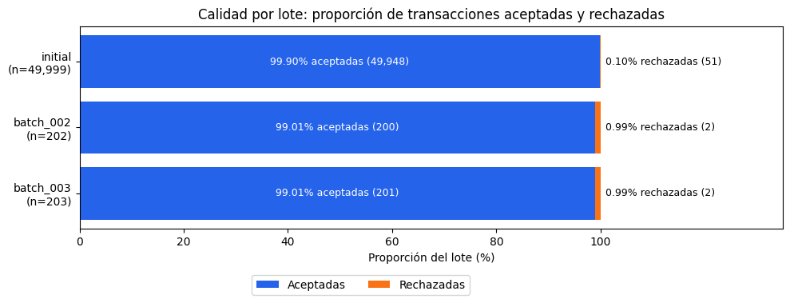

# Resolución Práctica 2 — Silver, Gold y orquestación

- **Nombre:** Tomás Fernández Addoumie
- **`student_id`:** `tfernandezaddoumie`
- **Escala:** `small`

## 1. Job

**Nombre del Job:** `bigdata_tfernandezaddoumie_silver_gold`



## 2. Resultados de la primera y segunda ejecución

```sql
SELECT * FROM workspace.bigdata_tfernandezaddoumie.pipeline_run_audit ORDER BY recorded_at;
```

| Ejecución | job_run_id | expected_batch_id | silver_rows | quarantine_rows | gold_rows | gold_total_amount | idempotence_compared |
|---|---|---|---:|---:|---:|---:|---|
| 1ª | 1112651856493980 | batch_002 | 50149 | 53 | 598 | 50286183.33 | false |
| 2ª | 789021784344547 | batch_002 | 50149 | 53 | 598 | 50286183.33 | true |

## 3. Aceptadas y rechazadas de `batch_002`

```sql
SELECT source_batch_id, accepted_transactions, rejected_transactions
FROM workspace.bigdata_tfernandezaddoumie.gold_batch_summary
WHERE source_batch_id = 'batch_002';
```

| source_batch_id | accepted_transactions | rejected_transactions |
|---|---:|---:|
| batch_002 | 200 | 2 |

## 4. `COPY INTO` y `MERGE`: problemas diferentes

COPY INTO y MERGE resuelven problemas diferentes porque el primero trabaja a nivel archivo y el segundo lo hace a nivel registro. 

En la ingesta de datos en Bronze, usamos COPY INTO para preguntarnos: “¿qué archivos de la carpeta todavía no cargué?”. Queda guardado en el log de la tabla Delta qué archivos ya procesó y los saltea en las siguientes corridas, así que reejecutar la ingesta no duplica datos en Bronze (en la segunda ejecución insertó 0 filas).

Por otro lado el MERGE lo usamos en Silver en el típico UPSERT y se pregunta “¿esta transacción es nueva, es una corrección de una que ya tengo, o no cambió nada?”. Usando transaction_id como clave, inserta las transacciones nuevas y actualiza las existentes solo si llega una versión más reciente.

## 5. Grano de las tablas Gold

| Tabla | Grano (una fila es…) |
|---|---|
| `gold_daily_sales` | un día × país × categoría × canal de pago |
| `gold_customer_risk` | un cliente con al menos una transacción |
| `gold_batch_summary` | un lote (`initial`, `batch_002`, `batch_003`) |

## 6. Visualizaciones

El código y las salidas completas están en `05_visualizacion.ipynb`.

### Consigna 1 — Evolución temporal



El día de mayor monto vendido y de mayor cantidad de transacciones es el mismo: 2026-03-01 ($7.310.840 en 7.236 transacciones). Esto implica un ticket promedio estable entre días, porque si el día de mayor monto vendido hubiera tenido menos transacciones que otro, sería porque ese día el ticket subió por algún motivo. Esto lo vemos en el último gráfico de líneas, donde para los primeros 7 días se mantiene alrededor de los $1.000.

### Consigna 2 — Canal y fraude



El canal con mayor tasa de fraude son las transferencias, con un 13,91% sobre el total de transacciones de ese canal, aproximadamente 1 punto por encima de wallet (12,97%) y card (12,54%). La tasa la calculé como fraudes sobre transacciones de cada canal y no promediando `fraud_rate`, porque cada fila de Gold tiene un volumen distinto.

Es útil el gráfico de la derecha sobre el volumen por canal porque nos permite entender si la tasa que informamos es representativa. En este caso vemos que lo es: los 3 canales tienen volúmenes similares y grandes (~16.700 transacciones cada uno). Si, por ejemplo, transfer tuviera solo 100 transacciones, una tasa del 30% sería poco confiable, porque unos pocos casos de más o de menos la moverían mucho; con 16.000 transacciones por canal eso no pasa.

### Consigna 3 — Concentración geográfica y de producto



Elegí un heatmap porque permite comparar una métrica en dos dimensiones simultáneamente: en este caso las categorías y los países, donde la intensidad del azul indica el monto en millones de $ y además cada celda tiene el valor escrito. La combinación de país y categoría que genera el mayor monto es la venta de artículos para el hogar en Brasil ($2,36 M).

No hay una categoría dominante en todos los países: home lidera en Brasil, Chile y Uruguay, y books en Argentina y México (en Chile la diferencia entre ambas es mínima: $2,17 M contra $2,16 M). Lo que sí se mantiene es que home y books son las dos categorías que más monto generan, primeras o segundas en todos los países.

Si bien creo que este dato es valioso, lo complementaría con la cantidad de transacciones por país para entender el market share entre categorías. Con este gráfico vemos que Brasil es el país con más monto en hogar, pero no nos dice si es el mercado donde más gente nos usa para comprar cosas para el hogar o si simplemente más cantidad de transacciones (lo que sería lógico en un mercado más grande como BR)

### Consigna 4 — Calidad del pipeline



La calidad de los dos lotes nuevos es la misma: 99,01% de registros aceptados (2 rechazos sobre 202 y 203 transacciones). En proporción, estos lotes tienen una tasa de rechazo mayor que la carga inicial, donde se aceptó el 99,90% (51 rechazos sobre casi 50.000). Es indispensable hacer la evaluación por proporciones y no con valores absolutos, porque eso nos podría llevar a pensar que “solo dos transacciones rechazadas no es grave”, cuando comparado con el estándar inicial la tasa de rechazo es casi 10 veces mayor.

De todas formas hay que tener en cuenta el tamaño de los lotes nuevos. Con ~200 registros, un solo rechazo de más o de menos mueve la tasa medio punto, mientras que en la carga inicial harían falta cientos.

## 7. Preguntas de análisis y comprensión

### Análisis de las tablas

### 1. ¿Cuántas filas físicas recibió cada lote en `bronze_transactions_incremental`? Escribí una consulta que muestre el resultado por `source_batch_id`.

```sql
SELECT source_batch_id, count(*) AS filas_fisicas
FROM workspace.bigdata_tfernandezaddoumie.bronze_transactions_incremental
GROUP BY source_batch_id
ORDER BY source_batch_id;
```

| source_batch_id | filas_fisicas |
|---|---:|
| batch_002 | 204 |
| batch_003 | 204 |

Cada lote recibió 204 filas físicas: 200 transacciones normales + 4 casos de prueba que agrega el generador (la corrección de la transacción 42, un duplicado exacto, un importe N/A y un cliente inexistente).

### 2. Para cada lote, ¿cuántas transacciones fueron aceptadas y cuántas quedaron en `silver_transactions_quarantine`? Reconciliá tus resultados con `gold_batch_summary`.

```sql
WITH aceptadas AS (
  SELECT source_batch_id, count(*) AS aceptadas_silver
  FROM workspace.bigdata_tfernandezaddoumie.silver_transactions
  GROUP BY source_batch_id
),
rechazadas AS (
  SELECT source_batch_id, count(*) AS rechazadas_cuarentena
  FROM workspace.bigdata_tfernandezaddoumie.silver_transactions_quarantine
  GROUP BY source_batch_id
)
SELECT g.source_batch_id,
       a.aceptadas_silver,      g.accepted_transactions,
       r.rechazadas_cuarentena, g.rejected_transactions
FROM workspace.bigdata_tfernandezaddoumie.gold_batch_summary g
LEFT JOIN aceptadas  a ON g.source_batch_id = a.source_batch_id
LEFT JOIN rechazadas r ON g.source_batch_id = r.source_batch_id
ORDER BY g.source_batch_id;
```

| source_batch_id | aceptadas_silver | accepted_transactions | rechazadas_cuarentena | rejected_transactions |
|---|---:|---:|---:|---:|
| batch_002 | 200 | 200 | 2 | 2 |
| batch_003 | 201 | 201 | 2 | 2 |
| initial | 49948 | 49948 | 51 | 51 |

En los dos lotes las cantidades de Silver y de la cuarentena coinciden exactamente con gold_batch_summary: batch_002 tiene 200 aceptadas y 2 rechazadas, y batch_003 tiene 201 aceptadas y 2 rechazadas. La diferencia de 1 entre lotes es la transacción 42: llegó corregida en los dos lotes, pero en Silver queda una sola versión (la más reciente, de batch_003), así que hoy cuenta como aceptada de batch_003.

### 3. ¿Qué motivos de rechazo aparecen en la cuarentena y cuántos registros tiene cada uno por lote? ¿Los rechazos observados coinciden con los casos introducidos por el generador?

```sql
SELECT source_batch_id, quality_reason, count(*) AS registros
FROM workspace.bigdata_tfernandezaddoumie.silver_transactions_quarantine
WHERE source_batch_id IN ('batch_002', 'batch_003')
GROUP BY source_batch_id, quality_reason
ORDER BY source_batch_id, quality_reason;
```

| source_batch_id | quality_reason | registros |
|---|---|---:|
| batch_002 | INVALID_AMOUNT | 1 |
| batch_002 | UNKNOWN_CUSTOMER | 1 |
| batch_003 | INVALID_AMOUNT | 1 |
| batch_003 | UNKNOWN_CUSTOMER | 1 |

Sí, coinciden con los casos que introduce el generador (generate_incremental_data.py). En cada lote agrega exactamente dos registros inválidos: uno con amount = 'N/A', que en Silver no se puede convertir a número y cae en INVALID_AMOUNT, y otro con customer_id = 5999, un cliente que no existe (los clientes van del 0 al 4999), que cae en UNKNOWN_CUSTOMER. Los otros dos casos de prueba no generan rechazos: el duplicado exacto se elimina en la deduplicación de Silver, y la corrección de la transacción 42 es válida y se aplica con el MERGE.

### 4. Seguí la transacción `42` desde `bronze_transactions_all` hasta `silver_transactions`. ¿Cuántas versiones existen en Bronze y cuál quedó vigente en Silver? Mostrá las columnas que justifican la elección.

```sql
SELECT transaction_id, source_batch_id, updated_at, amount, customer_id, product_id
FROM workspace.bigdata_tfernandezaddoumie.bronze_transactions_all
WHERE transaction_id = '42'
ORDER BY updated_at;
```

| transaction_id | source_batch_id | updated_at | amount | customer_id | product_id |
|---|---|---|---|---|---|
| 42 | initial | 2026-03-06 02:07:52 | 600.11 | 317 | 273 |
| 42 | batch_002 | 2026-03-10 02:00:00 | 1999.99 | 0 | 0 |
| 42 | batch_003 | 2026-03-11 02:00:00 | 1999.99 | 0 | 0 |

```sql
SELECT transaction_id, source_batch_id, updated_at, amount, customer_id, product_id
FROM workspace.bigdata_tfernandezaddoumie.silver_transactions
WHERE transaction_id = 42;
```

| transaction_id | source_batch_id | updated_at | amount | customer_id | product_id |
|---|---|---|---|---|---|
| 42 | batch_003 | 2026-03-11 02:00:00 | 1999.99 | 0 | 0 |

En Bronze hay 3 versiones y en Silver quedó una sola, la de `batch_003`, porque tiene el `updated_at` más reciente. Silver se queda con la última versión con un `ROW_NUMBER()` ordenado por `updated_at DESC`, y el `MERGE` solo actualiza si llega un `updated_at` mayor.

### 5. Comprobá mediante una consulta que `silver_transactions` tiene una sola fila por `transaction_id`. ¿Qué resultado indicaría que la deduplicación falló?

```sql
SELECT count(*) AS filas,
       count(DISTINCT transaction_id) AS ids_distintos
FROM workspace.bigdata_tfernandezaddoumie.silver_transactions;
```

| filas | ids_distintos |
|---:|---:|
| 50349 | 50349 |

La cantidad de filas es igual a la de `transaction_id` distintos, así que hay una sola fila por transacción lo que nos indica que la deduplicación no falló. 

### 6. Calculá la tasa de rechazo de cada lote como `rechazadas / (aceptadas + rechazadas)` en `gold_batch_summary`. ¿Es correcto comparar solamente las cantidades absolutas si los lotes tienen tamaños diferentes?

```sql
SELECT source_batch_id,
       accepted_transactions AS aceptadas,
       rejected_transactions AS rechazadas,
       accepted_transactions + rejected_transactions AS total,
       round(100 * rejected_transactions / (accepted_transactions + rejected_transactions), 2) AS tasa_rechazo_pct
FROM workspace.bigdata_tfernandezaddoumie.gold_batch_summary
ORDER BY source_batch_id;
```

| source_batch_id | aceptadas | rechazadas | total | tasa_rechazo_pct |
|---|---:|---:|---:|---:|
| batch_002 | 200 | 2 | 202 | 0.99 |
| batch_003 | 201 | 2 | 203 | 0.99 |
| initial | 49948 | 51 | 49999 | 0.10 |

Como vimos en el notebook de visualización, no es correcto comparar solo cantidades absolutas. Mirando los absolutos, la carga inicial parece la peor (51 rechazos contra 2), pero en proporción es la mejor: 0,10% contra 0,99% de los lotes nuevos, casi 10 veces menos. Igual hay que tener en cuenta que los lotes nuevos son muy chicos.

### 7. ¿Qué día presenta el mayor monto total y cuál presenta la mayor cantidad de transacciones? Consultá `gold_daily_sales` y explicá si ambos máximos coinciden.

```sql
WITH diario AS (
  SELECT sale_date,
         SUM(total_amount)      AS monto_total,
         SUM(transaction_count) AS transacciones
  FROM workspace.bigdata_tfernandezaddoumie.gold_daily_sales
  GROUP BY sale_date
)
(SELECT 'Mayor monto' AS criterio, * FROM diario ORDER BY monto_total DESC LIMIT 1)
UNION ALL
(SELECT 'Más transacciones' AS criterio, * FROM diario ORDER BY transacciones DESC LIMIT 1);
```

| criterio | sale_date | monto_total | transacciones |
|---|---|---:|---:|
| Mayor monto | 2026-03-01 | 7310840.77 | 7236 |
| Más transacciones | 2026-03-01 | 7310840.77 | 7236 |

Ambos máximos coinciden: el 2026-03-01 es el día de mayor monto y también el de más transacciones. Que coincidan indica un ticket promedio estable entre días, como se ve en el notebook de visualización.

### 8. ¿Qué canal de pago tiene la mayor tasa global de fraude? Calculala como `SUM(fraud_transactions) / SUM(transaction_count)` y explicá por qué no corresponde promediar directamente `fraud_rate`.

```sql
SELECT payment_channel,
       SUM(transaction_count)  AS transacciones,
       SUM(fraud_transactions) AS fraudes,
       round(100 * SUM(fraud_transactions) / SUM(transaction_count), 2) AS tasa_fraude_pct,
       round(100 * AVG(fraud_rate), 2) AS promedio_simple_pct
FROM workspace.bigdata_tfernandezaddoumie.gold_daily_sales
GROUP BY payment_channel
ORDER BY tasa_fraude_pct DESC;
```

| payment_channel | transacciones | fraudes | tasa_fraude_pct | promedio_simple_pct |
|---|---:|---:|---:|---:|
| transfer | 16723 | 2327 | 13.91 | 13.91 |
| wallet | 16724 | 2169 | 12.97 | 12.76 |
| card | 16902 | 2119 | 12.54 | 12.47 |

El canal con mayor tasa global de fraude es `transfer` (13,91%). No corresponde promediar `fraud_rate` porque es una tasa calculada para cada fila de Gold (día × país × categoría × canal), y cada fila tiene una cantidad de transacciones distinta: el promedio simple le da el mismo peso a un grupo de 1 transacción que a uno de 100. La tasa correcta se recalcula sumando numerador y denominador.

### 9. ¿Qué combinación de país y categoría concentra el mayor monto vendido? Mostrá también la combinación líder dentro de cada país.

```sql
WITH pais_categoria AS (
  SELECT country, category, SUM(total_amount) AS monto_total
  FROM workspace.bigdata_tfernandezaddoumie.gold_daily_sales
  GROUP BY country, category
),
ranking AS (
  SELECT *, ROW_NUMBER() OVER (PARTITION BY country ORDER BY monto_total DESC) AS rn
  FROM pais_categoria
)
SELECT country, category, monto_total
FROM ranking
WHERE rn = 1
ORDER BY monto_total DESC;
```

| country | category | monto_total |
|---|---|---:|
| BR | home | 2361959.97 |
| UY | home | 2323924.46 |
| AR | books | 2267722.26 |
| MX | books | 2235941.63 |
| CL | home | 2167748.03 |

La combinación con mayor monto es Brasil × home ($2,36 M), que es la primera fila: el máximo global es necesariamente el líder de su país. La categoría líder cambia según el mercado: home lidera en Brasil, Uruguay y Chile, y books en Argentina y México. Esto se visualiza de manera más clara en el gráfico del notebook de visualización con un heatmap. 

### 10. Compará las dos primeras filas de `pipeline_run_audit` correspondientes a la reejecución de `batch_002`. ¿Qué métricas permanecen iguales y qué columna demuestra que se realizó la comparación de idempotencia?

```sql
SELECT *
FROM workspace.bigdata_tfernandezaddoumie.pipeline_run_audit
ORDER BY recorded_at
LIMIT 2;
```

| job_run_id | expected_batch_id | silver_rows | quarantine_rows | gold_rows | gold_total_amount | recorded_at | idempotence_compared |
|---|---|---:|---:|---:|---:|---|---|
| 1112651856493980 | batch_002 | 50149 | 53 | 598 | 50286183.33 | 2026-10-03 13:13:25 | false |
| 789021784344547 | batch_002 | 50149 | 53 | 598 | 50286183.33 | 2026-10-03 13:33:16 | true |

Las cuatro métricas son iguales en ambas corridas: `silver_rows`, `quarantine_rows`, `gold_rows` y `gold_total_amount`. Solo cambian `job_run_id` y `recorded_at`, porque son dos ejecuciones distintas. La columna que demuestra la comparación es `idempotence_compared = true` en la segunda fila: el notebook 04 encontró una corrida anterior del mismo lote, exigió que las métricas fueran idénticas y recién ahí registró la fila. En la primera es `false` porque no había una corrida previa con la cual comparar.

### Interpretación del código y del pipeline

### 11. En `01_ingest_bronze_incremental.ipynb`, ¿qué problema resuelve `COPY INTO` y qué información utiliza para evitar cargar dos veces el mismo archivo físico?

**Referencia:** `01_ingest_bronze_incremental.ipynb`, celda 4 (`COPY INTO ... FROM '.../incoming/transactions/'`).

`COPY INTO` resuelve la **carga incremental**: cada vez que corre, lista la carpeta `incoming/transactions/` y carga en `bronze_transactions_incremental` solo los archivos que todavía no procesó, sin volver a leer los anteriores. Para saber cuáles ya cargó usa la **ruta de cada archivo**, que queda registrada en el log de transacciones (`_delta_log`) de la propia tabla Delta destino. Por eso es idempotente: en la segunda ejecución del Job insertó 0 filas, y en la tercera cargó solo `transactions_batch_003.csv` y salteó el de `batch_002`.

### 12. ¿Por qué la vista `bronze_transactions_all` usa `UNION ALL` en lugar de eliminar duplicados? ¿En qué capa se resuelven los duplicados de negocio y por qué?

**Referencia:** `01_ingest_bronze_incremental.ipynb`, celda 5 (`CREATE OR REPLACE VIEW bronze_transactions_all ... UNION ALL ...`) y `02_build_silver.ipynb`, celda 6 (`dropDuplicates` + `ROW_NUMBER`).

Usa `UNION ALL` porque Bronze tiene que conservar todo lo que llegó, tal cual, incluidos los duplicados, para poder auditar después qué se recibió. Además, un `UNION` solo eliminaría duplicados **exactos**, y los duplicados importantes son de negocio: la transacción 42 llega 3 veces con montos y fechas distintas, así que un `UNION` no la tocaría. Decidir qué versión vale es una regla de negocio (la de `updated_at` más reciente), y por eso se resuelve en **Silver**: primero `dropDuplicates` elimina los duplicados exactos y después `ROW_NUMBER()` por `transaction_id`, ordenado por `updated_at DESC`, se queda con la última versión de cada transacción.

### 13. ¿Por qué las transacciones iniciales reciben `source_batch_id='initial'` y usan `event_ts` como `updated_at`? ¿Cómo afecta eso a la corrección de la transacción `42`?

**Referencia:** `01_ingest_bronze_incremental.ipynb`, celda 5 (`'initial' AS source_batch_id, event_ts AS updated_at`).

Los datos de las transacciones (`bronze_transactions`) no tienen las columnas `source_batch_id` ni `updated_at`, porque no llegaron en lotes. Para poder unirlos con `UNION ALL` a los lotes incrementales, las dos partes necesitan las mismas columnas. Se les asigna `'initial'` para rotular su origen y se usa `event_ts` como `updated_at`, asumiendo que la versión original de una transacción se actualizó por última vez cuando ocurrió.

Esto afecta directamente a la 42: su versión inicial queda con `updated_at = 2026-03-06 02:07:52`, anterior a las correcciones de `batch_002` (`2026-03-10 02:00`) y `batch_003` (`2026-03-11 02:00`). Por eso, al ordenar por `updated_at DESC` en Silver, siempre gana la corrección más reciente.

### 14. En `quality_rules.py`, ¿qué ventaja ofrece `try_cast` frente a un `cast` convencional cuando llega un importe como `N/A`?

**Consulta / referencia:**

**Referencia:** `common/quality_rules.py`, función `add_transaction_types` (`try_cast(amount AS DECIMAL(12,2))`), y `add_quality_reason` (regla `INVALID_AMOUNT`).

Con un `cast` convencional, `cast('N/A' AS DECIMAL(12,2))` tira un error, lo que frenaría el Job. Con `try_cast`, el valor que no se puede convertir queda en `NULL` sin error, y el pipeline sigue. Ese `NULL` después lo detecta la regla de calidad (`amount_typed IS NULL` → `INVALID_AMOUNT`) y el registro va a la cuarentena con su motivo. Es lo que permite el patrón de aceptar los registros buenos y apartar los malos en lugar de frenar todo. Además, la función conserva la columna original en texto, así que en la cuarentena queda guardado el `'N/A'` tal como llegó.

### 15. Las reglas de calidad asignan una única `quality_reason`. ¿Qué sucede si un registro viola más de una regla y por qué importa el orden de las condiciones?

**Referencia:** `common/quality_rules.py`, función `add_quality_reason` (cadena de `F.when(...).when(...)`).

La función es un `CASE WHEN` encadenado: devuelve la **primera** condición que se cumple y no evalúa el resto. Si un registro viola más de una regla, solo queda registrado el primer motivo. Por ejemplo, un registro con `amount = 'N/A'` y un cliente inexistente quedaría solo como `INVALID_AMOUNT`.

El orden importa porque define la prioridad del diagnóstico. Primero van las reglas de formato y tipo, y al final las referenciales (`UNKNOWN_CUSTOMER`, `UNKNOWN_PRODUCT`). Si llega `customer_id = 'abc'`, el `try_cast` da `NULL` y el `LEFT JOIN` tampoco encuentra el cliente: con este orden cae en `INVALID_CUSTOMER_ID`, que es el problema real. Si `UNKNOWN_CUSTOMER` estuviera primero, se lo etiquetaría como un cliente inexistente cuando en realidad el id está mal formado.

### 16. Explicá cómo se construye `_record_key` y cómo se usa junto con `row_number`. ¿Qué caso cubre el hash cuando `transaction_id` no puede convertirse a un número?

**Referencia:** `02_build_silver.ipynb`, celda 6 (`record_key = F.coalesce(...)` y `Window.partitionBy("_record_key")`).

`_record_key` es la clave con la que se agrupan las versiones de una misma transacción. Se construye con un `COALESCE`: si `transaction_id_typed` existe, usa ese id; si es `NULL`, usa un `sha2` (hash de 256 bits) de las 10 columnas originales concatenadas, reemplazando los `NULL` por `'<NULL>'` para que dos filas distintas no generen el mismo texto. Después, `ROW_NUMBER() OVER (PARTITION BY _record_key ORDER BY updated_at_typed DESC, source_batch_id DESC)` numera las versiones de cada clave y se queda con `_rn = 1`, la más reciente.

El hash cubre el caso de un `transaction_id` inválido (por ejemplo `'abc'` o vacío), que al tipar queda en `NULL`. Si se particionara directamente por el id tipado, todas esas filas caerían en un mismo grupo `NULL`, el `ROW_NUMBER` dejaría una sola y las demás desaparecerían sin quedar ni en Silver ni en la cuarentena. Con el hash, cada fila inválida forma su propio grupo, sobrevive con `_rn = 1` y llega a la cuarentena con `INVALID_TRANSACTION_ID`.

### 17. Interpretá las dos cláusulas principales del `MERGE` de `silver_transactions`. ¿Cuándo se actualiza una fila existente y cuándo se inserta una nueva?

**Referencia:** `02_build_silver.ipynb`, celda 7.

```sql
MERGE INTO silver_transactions t
USING _valid_transactions s
ON t.transaction_id = s.transaction_id
WHEN MATCHED AND s.updated_at > t.updated_at THEN UPDATE SET *
WHEN NOT MATCHED THEN INSERT *
```

El `MERGE` compara cada transacción válida que llega (`s`) con la tabla Silver (`t`) usando `transaction_id` como clave:

- **`WHEN NOT MATCHED THEN INSERT`**: si el `transaction_id` no existe en Silver, se inserta. Es el caso de las 200 transacciones nuevas de cada lote.
- **`WHEN MATCHED AND s.updated_at > t.updated_at THEN UPDATE`**: si ya existe y la versión que llega es más reciente, se pisa la fila completa. Es el caso de la corrección de la transacción 42.
- Si ya existe pero la versión no es más reciente, no se hace nada. Esa condición es la que hace al `MERGE` idempotente: al reejecutar con los mismos datos, ningún `updated_at` es mayor, así que no cambia nada. Además, evita que una versión vieja que llegue tarde pise a una más nueva.


### 18. ¿Por qué las tablas Gold se reconstruyen completamente en esta práctica mientras Silver se actualiza con `MERGE`? Mencioná una ventaja y una limitación de cada estrategia.

**Referencia:** `02_build_silver.ipynb`, celda 7 (`MERGE INTO silver_transactions`), y `03_build_gold.ipynb`, celdas 4 a 6 (`CREATE OR REPLACE TABLE gold_...`).

Silver es la fuente de verdad: tiene una fila por transacción identificada por una clave (`transaction_id`), así que tiene sentido actualizarla de forma incremental con `MERGE`, insertando lo nuevo y corrigiendo lo que cambió. Gold, en cambio, son agregaciones que se pueden recalcular completas a partir de Silver, por eso se reconstruyen con `CREATE OR REPLACE` en cada corrida.

Silver solo modifica lo necesario (inserta nuevas y actualiza correcciones) sin reescribir toda la tabla. Esto hace que la lógica sea más compleja (clave, condición de `updated_at`, deduplicación previa obligatoria) pero logra que si el `MERGE` tiene un error, el dato incorrecto queda persistido.
La carga de Gold es simple y siempre queda consistente con Silver. Por ejemplo, cuando se corrigió la 42 (cambió de cliente, producto y día), pasó solo al grupo correcto sin lógica extra. Como desventaja podríamos mencionar el costo de recalcular todo cada vez que se crean las tablas. Es como que se va "pisando", pero al ser datos agregados y pocos registros en comparación a Silver no es significativo. 

### 19. ¿Por qué `expected_batch_id` no participa en la detección del archivo nuevo? Indicá qué parte del pipeline descubre `batch_003` y qué parte utiliza el parámetro.

**Referencia:** `01_ingest_bronze_incremental.ipynb`, celda 4 (`COPY INTO`), y `04_validate_pipeline.ipynb`, celdas 4 y 5.

El que descubre `batch_003` es el `COPY INTO` del notebook 01: lista la carpeta `incoming/transactions/`, compara contra su registro de archivos ya cargados y toma `transactions_batch_003.csv` porque es nuevo, sin usar ningún parámetro. El parámetro `expected_batch_id` lo usa solo el notebook 04, para saber qué lote verificar: que haya llegado a Bronze y a Silver, que tenga sus rechazos en cuarentena, que aparezca en `gold_batch_summary` y que la corrección de la 42 venga de ese lote.

Está separado a propósito: un pipeline real corre de forma programada y no sabe de antemano cómo se llama el archivo que va a llegar, así que tiene que procesar lo que haya sin que nadie cambie parámetros. `expected_batch_id` es una expectativa del test, no una instrucción del ETL. Si se deja en `batch_002` después de cargar `batch_003`, las tareas 01 a 03 procesan el lote nuevo sin problemas, pero `validate` falla. Me pasó al correr el notebook 04 a mano: falló el control `historical_correction_applied`, porque la 42 ya venía de `batch_003` y no de `batch_002` cuando yo había dejado el 002 como `expected_batch_id`. El error indicaba una expectativa de prueba incorrecta, no un problema del pipeline.

### 20. Si la tarea `build_silver` falla, ¿qué ocurre con `build_gold` y `validate` en el Job? Explicá cómo las dependencias del DAG evitan publicar o validar resultados incompletos.

En el DAG, `build_gold` depende de `build_silver` y `validate` depende de `build_gold`, y por defecto cada tarea corre solo si todas las anteriores terminaron bien. Si `build_silver` falla, `build_gold` y `validate` no se ejecutan: quedan como *Upstream failed* y la corrida del Job queda marcada en rojo.

Así se evitan resultados incompletos: como `build_gold` no corre, las tablas Gold no se reconstruyen sobre un Silver a medias y conservan la versión de la última corrida exitosa. Como `validate` tampoco corre, no se agrega ninguna fila a `pipeline_run_audit`, y la auditoría solo registra corridas completas.
